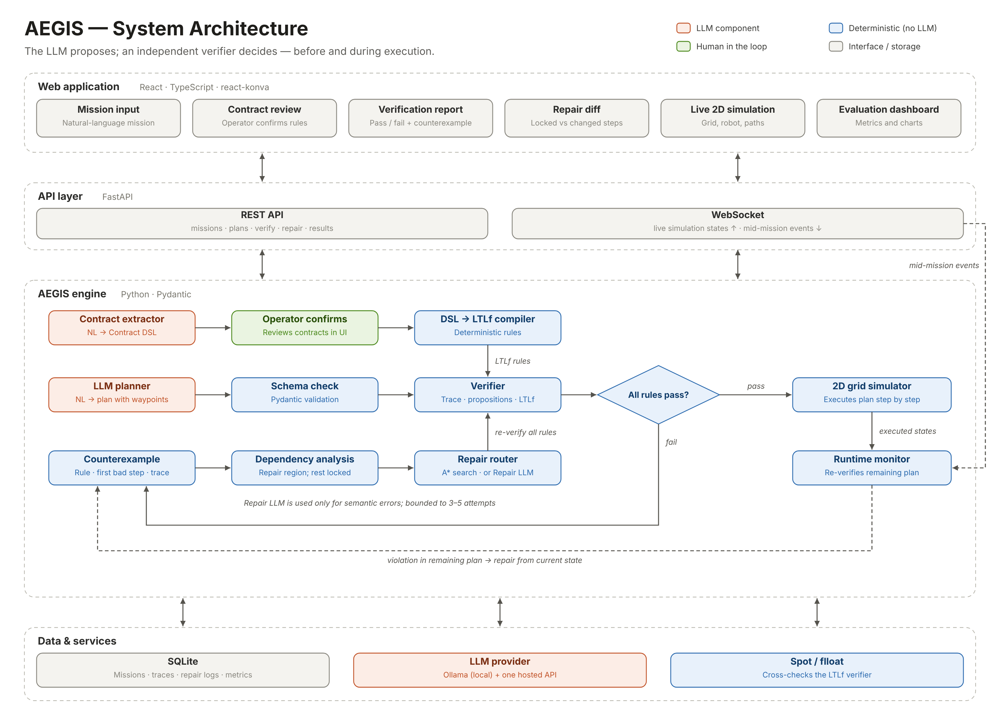
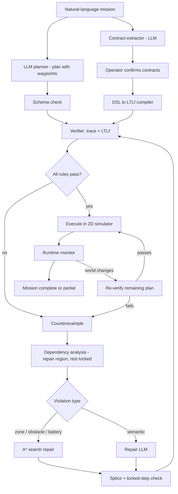
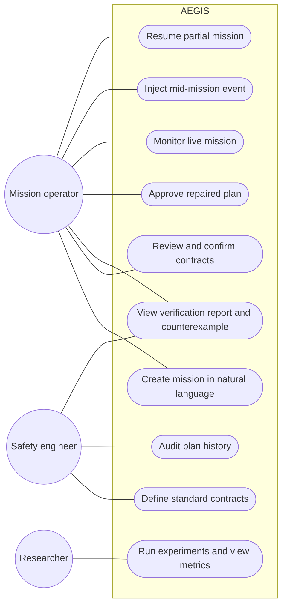
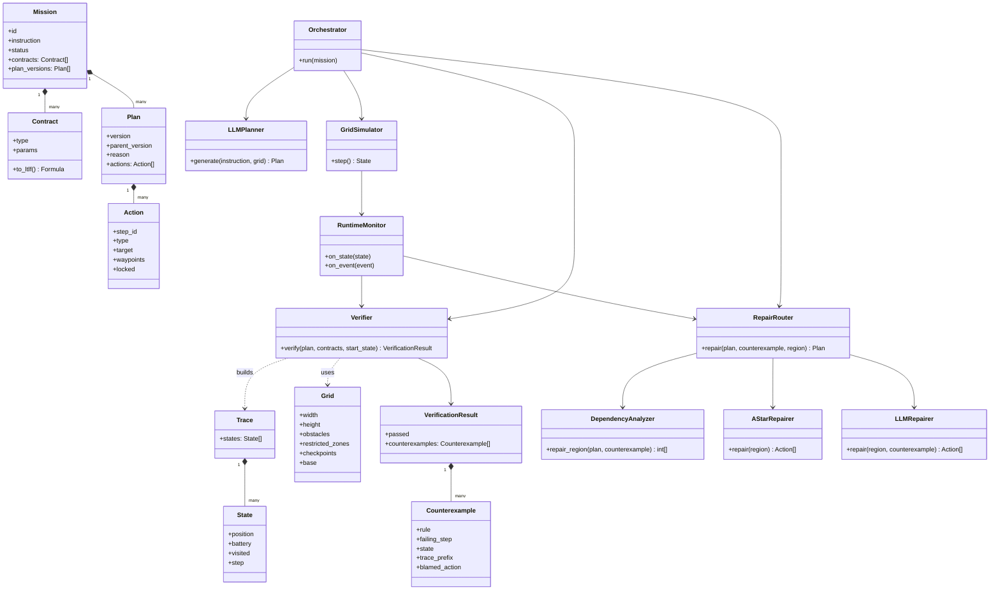
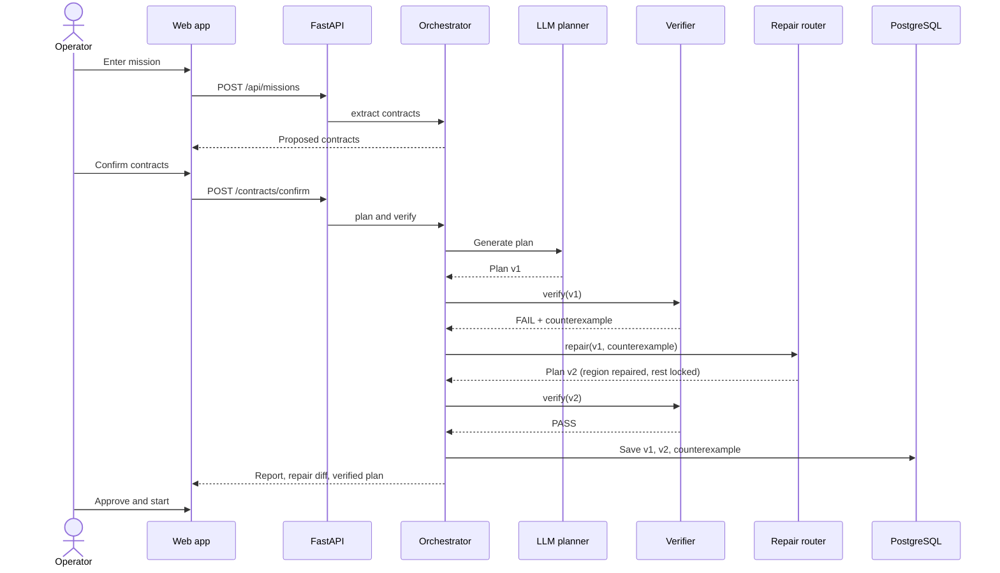
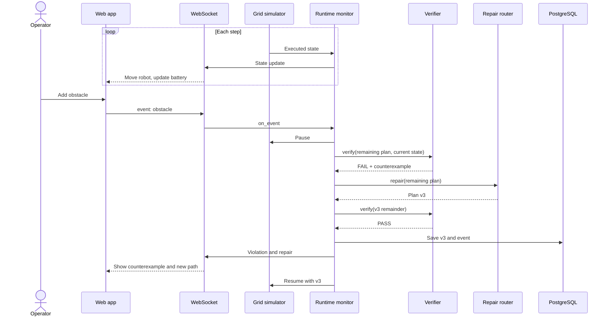
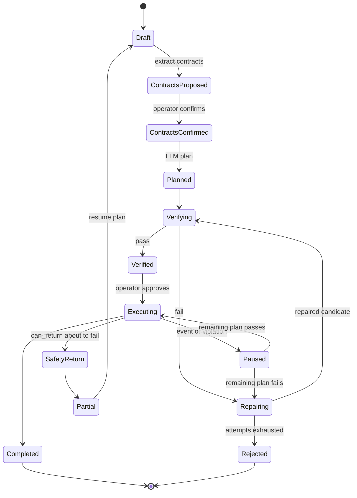
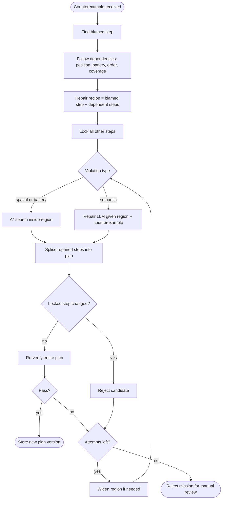
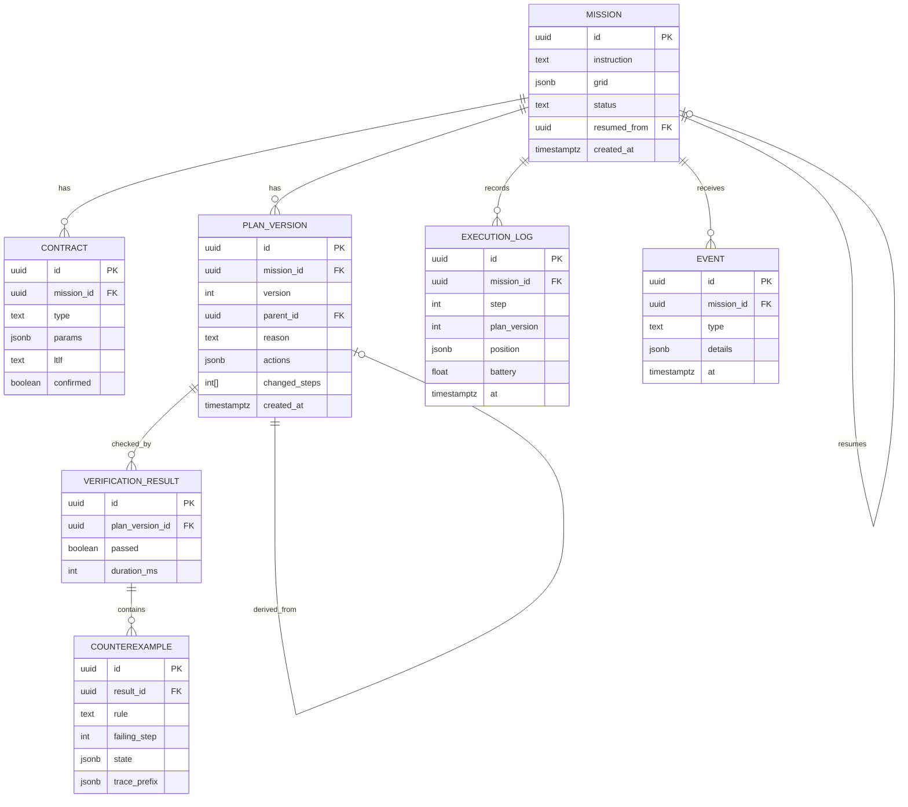

# AEGIS

**Contract-based verification and counterexample-guided repair of LLM-generated mission plans, before and during execution.**

AEGIS is a safety layer for autonomous systems that take instructions in natural language. A large language model (LLM) proposes a mission plan; an independent, deterministic verifier decides whether the plan is safe. When a plan breaks a rule, AEGIS repairs only the affected steps instead of discarding the whole plan, and it keeps checking the plan while the mission runs.

> **Status:** in active development (final-year major project). AEGIS is software-only and runs in a 2D grid simulation. No hardware is required.

---

## Table of contents

1. [Problem statement](#problem-statement)
2. [Motivation](#motivation)
3. [Objectives](#objectives)
4. [Users](#users)
5. [Base paper and research gap](#base-paper-and-research-gap)
6. [Contributions](#contributions)
7. [System architecture](#system-architecture)
8. [How it works](#how-it-works)
9. [Worked example](#worked-example)
10. [Key concepts](#key-concepts)
11. [UML diagrams](#uml-diagrams)
12. [Mission contracts](#mission-contracts)
13. [API reference](#api-reference)
14. [Tech stack](#tech-stack)
15. [Repository structure](#repository-structure)
16. [Getting started](#getting-started)
17. [Dataset](#dataset)
18. [Evaluation](#evaluation)
19. [Limitations](#limitations)
20. [Future work](#future-work)
21. [References](#references)
22. [Team](#team)
23. [License](#license)

---

## Problem statement

LLMs can turn a natural-language instruction such as *"Inspect A, B and C, avoid zone R1, keep a 20% battery reserve and return to base"* into a structured mission plan. However, LLM-generated plans can violate safety and operational requirements while appearing correct: a route may cross a restricted zone, the battery may run out before the robot returns, or a required checkpoint may be skipped.

Existing work verifies plans before execution and, when a plan fails, regenerates the entire plan. This has three problems:

1. **Regeneration is wasteful and risky.** It can change steps that were already correct and introduce new errors.
2. **Pre-execution checking is not enough.** A verified plan can become unsafe when the environment changes during the mission.
3. **LLMs should not judge LLMs.** The final safety decision should be made by deterministic, explainable logic.

**AEGIS asks:** how can LLM-generated mission plans be formally verified before and during execution, and repaired with minimal, targeted changes, so that the final plan satisfies every mission contract?

## Motivation

- **LLM planners are entering real systems.** Companies are building natural-language control for drones, for example [BAE Systems](https://www.baesystems.com/en/insight/how-ai-can-help-frontline-drone-operators) and [Scout AI's Fury](https://newatlas.com/military/video-fury-ai-platform-battlefield-drones/).
- **Strong planners can still be unsafe.** A 2026 benchmark of 23 LLMs found that the best-planning model failed to produce a valid plan on only 0.4% of tasks but produced dangerous plans on 28.3% ([DESPITE, arXiv 2604.18463](https://arxiv.org/html/2604.18463)).
- **The violations AEGIS checks cause real accidents.** In an NTSB-investigated incident, a drone pilot was unaware of a restricted zone around a prison; during return-to-home the battery fell to 7% and the pilot was injured ([NTSB CEN21LA224](https://data.ntsb.gov/carol-repgen/api/Aviation/ReportMain/GenerateNewestReport/103104/pdf)). Restricted zones and battery reserve are core AEGIS contracts.

## Objectives

1. **Measure** how often LLM planners produce plans that violate mission contracts, by model, mission difficulty and violation type.
2. **Build** an independent verifier that checks plans against LTLf contracts and produces counterexamples.
3. **Develop** dependency-aware targeted repair that changes only the affected steps, choosing search-based or LLM-based repair by violation type.
4. **Extend** verification to runtime, so mid-mission changes trigger re-verification and local repair of the remaining plan.
5. **Evaluate** AEGIS against LLM-only, verify-and-reject and full-regeneration baselines in a 2D web simulation.

## Users

AEGIS is built for **organisations that operate autonomous systems**, not for the general public. It sits inside a company's mission-planning software as a safety layer between the LLM and the robot.

| User | What they do with AEGIS | Why they need it |
|---|---|---|
| **Mission operators** (primary) | Write missions in plain language, confirm extracted rules, approve plans, monitor missions live, inject or respond to mid-mission events | They are not formal-methods experts but need to trust that an AI-generated plan is safe |
| **Safety and system engineers** | Define standard contracts (zones, reserves, checkpoints), audit counterexamples and plan histories | They need evidence that every plan was checked against explicit rules |
| **Robotics researchers and developers** | Compare LLMs and repair strategies on the evaluation dashboard | They need measurable error rates and repair quality |

**Example organisations:** drone inspection companies (power lines, bridges, solar farms), warehouse and logistics robot operators, agricultural robotics companies, industrial inspection robots.

**Domain independence:** AEGIS works on three abstractions (states, actions and temporal rules), so the same engine applies to drones, ground robots and other autonomous systems; only the contract set and action types change. The prototype demonstrates this on a 2D grid.

## Base paper and research gap

**Base paper:** M. A. Zuzuárregui and S. Carpin, *"As You Wish: Mission Planning with Formal Verification using LLMs in Precision Agriculture,"* IEEE ICRA 2026 ([arXiv:2606.18519](https://arxiv.org/abs/2606.18519)).

As You Wish uses one LLM to write the mission plan (XML), a second to write co-safe LTL, and a third LLM from a different provider as an arbiter. Plans are checked in SPIN, and failures are sent back for regeneration. It was evaluated in Gazebo with ROS2 on precision-agriculture missions.

| As You Wish | AEGIS |
|---|---|
| Regenerates the whole output on failure | Repairs only the affected steps; the rest are locked |
| Verifies before execution only | Also monitors and re-verifies during execution |
| Co-safe LTL cannot express "always" properties | LTLf supports safety rules such as `G ¬in_restricted` |
| Does not check spatial meta-constraints such as field boundaries | Zones, obstacles and battery are checked state by state |
| An LLM arbiter judges whether intent is met | Pass/fail is decided by deterministic code; the operator confirms rules |
| Precision agriculture only | Designed to be domain-independent |

## Contributions

1. **Runtime verification and repair:** the same LTLf verifier re-checks the remaining plan from the current state when the world changes, before the robot reaches the problem.
2. **Dependency-aware targeted repair:** a repair region is computed from the counterexample and its downstream effects (position, battery, ordering, coverage); all other steps are locked and enforced in code.
3. **Routed repair:** A* search for spatial and battery violations, a repair LLM only for semantic violations, with an empirical comparison of the three strategies.
4. **A mission benchmark** with planted errors and runtime events, released with the code.

AEGIS does not claim to be the first system to combine LLMs with temporal-logic verification; see [References](#references).

## System architecture



| Layer | Responsibility |
|---|---|
| **Web application** (React) | Mission input, contract review, verification report, repair diff, live 2D simulation, evaluation dashboard |
| **API layer** (FastAPI) | REST for missions, plans, verification and repair; WebSocket for live simulation states and mid-mission events |
| **AEGIS engine** (Python) | Contract extraction and compilation, planning, verification, counterexamples, dependency analysis, repair, simulation, runtime monitoring |
| **Data and services** | PostgreSQL for missions, plan versions and logs; LLM providers (Ollama and a hosted API); optional Spot/flloat cross-check |

**Design principle:** the LLM proposes; deterministic code decides. LLM components are the contract extractor, the planner and the semantic repairer. Everything that decides safety is deterministic.

## How it works



1. **Contracts.** The LLM extracts rules from the instruction into a Contract DSL. The operator confirms them, and a deterministic compiler turns them into LTLf formulas.
2. **Planning.** The LLM writes a plan as actions with explicit waypoints, so the LLM chooses the route and its route errors are visible to the verifier.
3. **Verification.** The plan is replayed cell by cell on the grid to build a state trace. Each state is labelled with propositions and checked against every formula.
4. **Counterexample.** On failure the verifier reports the rule, the first violating step, the state and the trace prefix.
5. **Targeted repair.** Dependency analysis computes the repair region. The router picks A* or the repair LLM. The fixed part is spliced in, locked steps are checked, and the whole plan is re-verified. At most 3–5 attempts; otherwise the mission is rejected for manual review.
6. **Runtime.** The simulator executes the plan step by step. The monitor checks each state and, when an event occurs, re-verifies the remaining plan from the current state and runs the same repair loop on it.
7. **History.** Every plan version is stored. Executed steps are never changed.

## Worked example

**Mission:** inspect A, B and C; avoid zone R1; keep a 20% battery reserve; return to base.

```
LLM plan (v1)
1. Start at Base (0,0)
2. Move to A (2,0)
3. Inspect A
4. Move to B (2,5) via (2,1) (2,2) (2,3) (2,4)   ← (2,2), (2,3) inside R1
5. Inspect B
6. Move to C (6,5)
7. Inspect C
8. Return to Base

Counterexample
Rule: G ¬in_restricted        First violating step: 4, cell (2,2)

Repair region: step 4 (steps 5–8 re-checked for battery)
Locked: steps 1, 2, 3, 5, 6, 7, 8

A* repair (v2)
4. Move to B (2,5) via (1,1) (1,2) (1,3) (1,4)

Re-verify: all contracts pass → 7 of 8 steps preserved (87.5%)
```

**Mid-mission:** after step 5 the operator adds an obstacle on the path to C. The monitor re-verifies the remaining plan from the robot's current state, finds the violation before the robot reaches it, repairs only steps 6–8 (v3), re-verifies and continues. If the battery later drains faster than predicted, the `can_return` rule triggers a safety return (v4); the mission ends as *partially complete* and the unfinished steps become a resume plan that must be verified and approved.

## Key concepts

**LTLf (Linear Temporal Logic over finite traces).** Temporal logic describes rules over time. Standard LTL assumes infinite executions; missions end, so AEGIS uses the finite-trace version.

| Operator | Meaning | Example |
|---|---|---|
| `G φ` | φ holds at every step (safety) | `G ¬in_restricted` |
| `F φ` | φ holds at some step (liveness) | `F inspected_A` |
| `φ U ψ` | φ holds until ψ becomes true (ordering) | `¬inspected_B U inspected_A` |

**Counterexample.** The evidence that a rule failed: the rule, the first violating step, the state and the sequence of states leading to it. AEGIS uses it to know exactly what to repair.

**Repair region and locked steps.** The broken step plus every later step whose position, battery, ordering or coverage depends on it. All other steps are locked; a candidate that changes a locked step is rejected.

**Preservation rate.** The share of the original plan's steps that remain unchanged after repair.

**Runtime monitor.** Checks every executed state, and re-verifies the remaining plan from the current state whenever the environment changes.

## UML diagrams

### Use case diagram



### Class diagram



### Sequence diagram: verification and repair before execution



### Sequence diagram: runtime event



### State diagram: mission lifecycle



### Activity diagram: targeted repair



### Entity-relationship diagram (PostgreSQL)



## Mission contracts

| Contract | LTLf | Type |
|---|---|---|
| NoFlyZone | `G ¬in_restricted` | Safety |
| ObstacleAvoidance | `G ¬in_obstacle` | Safety |
| BatteryReserve | `G battery_ok` | Safety |
| CanReturn | `G can_return` | Safety (look-ahead) |
| WaypointCoverage | `F inspected_A ∧ F inspected_B ∧ …` | Liveness |
| Sequencing | `¬inspected_B U inspected_A` | Ordering |
| ReturnToBase | `F (at_base ∧ last)` | Liveness |

Altitude and time-window contracts are out of scope because the simulator is 2D.

## API reference

Planned endpoints (subject to change during development).

| Method | Endpoint | Purpose |
|---|---|---|
| `POST` | `/api/missions` | Create a mission from natural language |
| `GET` | `/api/missions/{id}` | Mission details and status |
| `POST` | `/api/missions/{id}/contracts/confirm` | Confirm or edit extracted contracts |
| `POST` | `/api/missions/{id}/plan` | Generate a plan |
| `POST` | `/api/plans/{id}/verify` | Verify a plan; returns counterexamples |
| `POST` | `/api/plans/{id}/repair` | Run targeted repair |
| `GET` | `/api/missions/{id}/plans` | All plan versions |
| `POST` | `/api/missions/{id}/execute` | Start execution |
| `POST` | `/api/missions/{id}/resume` | Build and verify a resume plan |
| `GET` | `/api/results` | Evaluation metrics for the dashboard |

**WebSocket** `/ws/missions/{id}`

| Direction | Message |
|---|---|
| Server → client | `state`, `violation`, `repair`, `status` |
| Client → server | `event` (`obstacle`, `zone_closed`, `battery_drop`), `pause`, `resume` |

## Tech stack

| Layer | Technology |
|---|---|
| Engine | Python 3.10+, Pydantic |
| Verification | Custom LTLf evaluator (optional cross-check with Spot or flloat) |
| Repair | A* search, LLM repair |
| LLMs | Local models via Ollama; one hosted model via API |
| API | FastAPI (REST + WebSocket), Uvicorn |
| Database | PostgreSQL, SQLAlchemy, psycopg, Alembic |
| Frontend | React, TypeScript, Vite, react-konva, Zustand, Recharts |
| Testing | pytest |

## Repository structure

```
Aegis/
├── backend/
│   ├── aegis/
│   │   ├── core/          # Plan, Action, State, Trace, Grid, Mission
│   │   ├── contracts/     # DSL, templates, LTLf compiler, LLM extractor
│   │   ├── planner/       # LLM planner and plan schema
│   │   ├── verifier/      # Trace builder, propositions, LTLf, counterexamples
│   │   ├── repair/        # Dependency analysis, router, A*, LLM repair, splice, loop
│   │   ├── runtime/       # Monitor, events, resume plans
│   │   ├── simulation/    # 2D grid simulator
│   │   ├── llm/           # Provider-independent client (Ollama, Anthropic, OpenAI)
│   │   ├── pipeline/      # Orchestrator and config
│   │   └── utils/
│   ├── api/               # FastAPI routes, WebSocket, database
│   ├── evaluation/        # Experiments, metrics, analysis
│   ├── missions/          # Mission dataset
│   ├── configs/
│   ├── tests/
│   ├── scripts/
│   └── docs/
├── frontend/
│   └── src/               # components, pages, hooks, services, store, types
├── docs/images/           # Diagrams used in this README
├── LICENSE
└── README.md
```

## Getting started

### Prerequisites

- Python 3.10+
- Node.js 18+
- [PostgreSQL](https://www.postgresql.org/download/) 14+
- [Ollama](https://ollama.com) for local models (optional if you use a hosted API)

### Database

```sql
CREATE DATABASE aegis;
```

### Backend

```bash
cd backend
python -m venv .venv
source .venv/bin/activate          # Windows: .venv\Scripts\activate
pip install -r requirements.txt
cp .env.example .env               # Windows: copy .env.example .env
                                   # then set DATABASE_URL in .env
uvicorn api.main:app --reload      # http://localhost:8000
```

Pull a local model if you use Ollama:

```bash
ollama pull llama3.1:8b
```

### Frontend

```bash
cd frontend
npm install
cp .env.example .env
npm run dev                        # http://localhost:5173
```

### Tests

```bash
cd backend
pytest
```

## Dataset

There is no public dataset for this exact task, so AEGIS uses its own mission set (about 100 missions), released with the code:

- **Difficulty levels:** easy, medium, hard and adversarial, combining zones, obstacles, ordering and battery limits.
- **Planted errors:** zone, obstacle, battery, missing checkpoint, ordering, return-to-base and multiple interacting violations.
- **Runtime events:** new obstacles, closed zones and faster battery drain during execution.
- **Real-world grounding:** maps derived from real areas, restricted zones based on published airspace zoning, and scenarios recreating documented incidents.
- **Ground truth:** expected verification outcomes labelled by hand.
- **Instructions written by people other than the developers**, to reduce bias.

## Evaluation

| Method | Description |
|---|---|
| LLM only | Plans executed without verification |
| Verify + reject | Invalid plans are rejected |
| Verify + regenerate | Invalid plans are fully regenerated (As You Wish style) |
| AEGIS (LLM repair) | Targeted repair using the LLM only |
| AEGIS (search repair) | Targeted repair using search only |
| AEGIS (full) | Routed, dependency-aware repair + runtime monitoring |

**Metrics:** LLM invalid-plan rate (by model, difficulty and violation type), verification accuracy against ground truth, repair success rate, repair iterations and time, preservation rate, final violation rate, and runtime detection before the violation is reached.

Experiments use at least two LLMs (one local, one hosted) with several runs per mission. Model names, versions and settings are logged for reproducibility.

Results will be added once the experiments are complete.

## Limitations

- Evaluated in a 2D grid simulation, not on physical robots.
- Missions are short and finite; altitude and time-window rules are out of scope.
- The LLM still extracts contracts and proposes plans; the operator must confirm contracts before planning.
- The battery model is simplified (fixed cost per move).
- Designed to be domain-independent, but demonstrated on a limited set of scenarios.

## Future work

- Execution on real autopilot software in simulation (ArduPilot or PX4 SITL)
- Multi-robot missions and task reallocation
- Continuous and 3D environments with altitude constraints
- Learning repair strategies from past repairs
- A user study with professional operators

## References

1. M. A. Zuzuárregui and S. Carpin, "As You Wish: Mission Planning with Formal Verification using LLMs in Precision Agriculture," *IEEE ICRA*, 2026. [arXiv:2606.18519](https://arxiv.org/abs/2606.18519)
2. M. A. Zuzuárregui and S. Carpin, "Leveraging LLMs for Mission Planning in Precision Agriculture," *IEEE ICRA*, 2025. [arXiv:2506.10093](https://arxiv.org/abs/2506.10093)
3. VerifyLLM: LLM-based pre-execution task plan verification for robots. [arXiv:2507.05118](https://arxiv.org/abs/2507.05118)
4. LIMP: Verifiably following complex robot instructions with foundation models. [arXiv:2402.11498](https://arxiv.org/abs/2402.11498)
5. DESPITE: Safety evaluation of LLMs for embodied planning, 2026. [arXiv:2604.18463](https://arxiv.org/html/2604.18463)
6. Spot: a platform for LTL and ω-automata manipulation. [spot.lre.epita.fr](https://spot.lre.epita.fr/)

## Team

| Role | Name |
|---|---|
| Team Lead | Humera Mahreen |
| Team Member | Fazal Unnisa |

<!-- Add project guide and institution -->

## License

This project is licensed under the MIT License. See [LICENSE](LICENSE) for details.

Copyright (c) 2026 Humera Mahreen and Fazal Unnisa